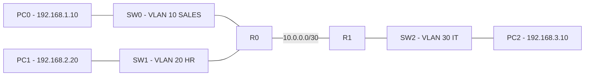

# CCNA Multi-Router VLAN Lab

## Overview
A hands-on Cisco Packet Tracer project for practicing CCNA networking concepts, routing, VLAN configuration, and connectivity troubleshooting.

## Network Topology



## Devices
- 2 Routers: R0 and R1
- 3 Switches: SW0, SW1, and SW2
- 3 PCs: PC0, PC1, and PC2

## VLANs

| VLAN ID | Name | Network |
|---|---|---|
| 10 | SALES | 192.168.1.0/24 |
| 20 | HR | 192.168.2.0/24 |
| 30 | IT | 192.168.3.0/24 |

## IP Addressing

| Device | Interface | IP Address |
|---|---|---|
| R0 | G0/0.10 | 192.168.1.1/24 |
| R0 | G0/1.20 | 192.168.2.1/24 |
| R0 | G0/2 | 10.0.0.1/30 |
| R1 | G0/1.30 | 192.168.3.1/24 |
| R1 | G0/2 | 10.0.0.2/30 |
| PC0 | NIC | 192.168.1.10/24 |
| PC1 | NIC | 192.168.2.20/24 |
| PC2 | NIC | 192.168.3.10/24 |

## Concepts Practiced
- VLAN configuration
- 802.1Q trunking
- Router-on-a-Stick
- Static routing
- IPv4 addressing and subnetting
- Cisco IOS CLI
- Connectivity testing and troubleshooting

## Verification Commands

The following commands are useful for checking device configuration and status:

```text
show ip interface brief
show ip route
show vlan brief
show interfaces trunk
show running-config
```

## Connectivity Testing
ICMP ping tests were used to verify connectivity between PCs on different LANs. Successful connectivity was observed between PC0 and PC2.

## Project File
`CCNA_Multi_Router_VLAN_Lab_Final.pkt`

## Learning Outcomes
- Practice configuring routers and switches
- Understand VLANs and trunk links
- Configure static routes between routers
- Verify connectivity and troubleshoot network issues

---
Project created as part of hands-on CCNA review and networking practice.
